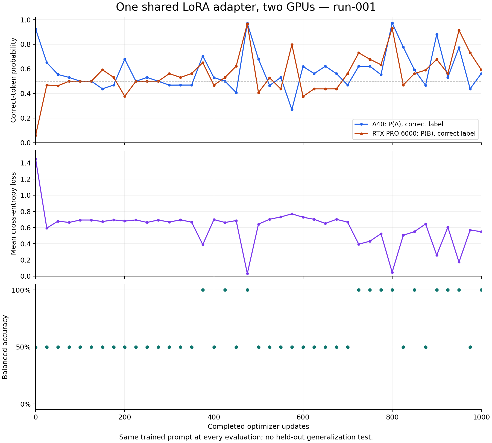
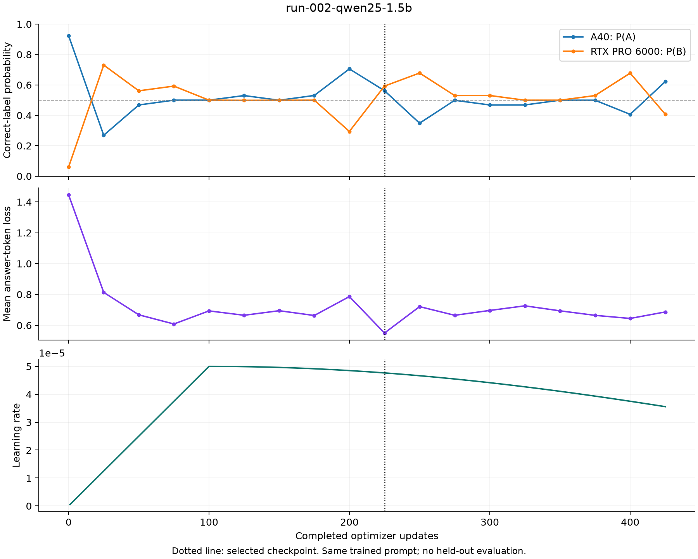
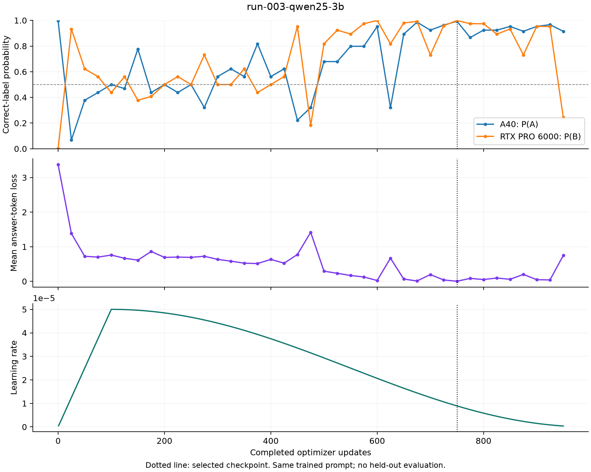
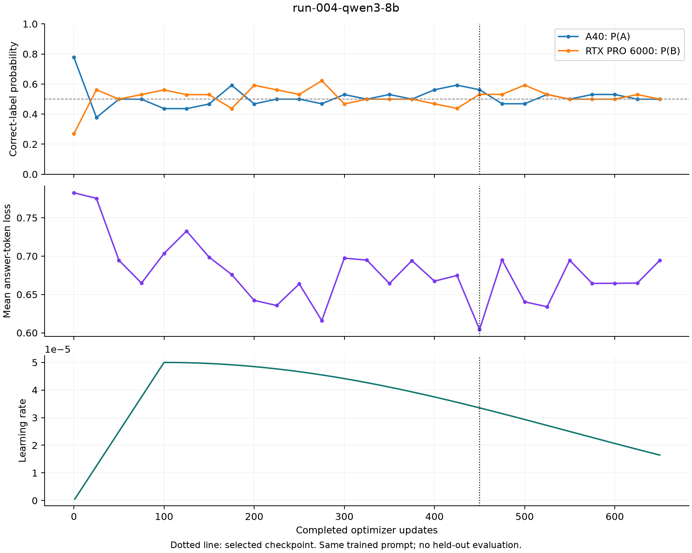
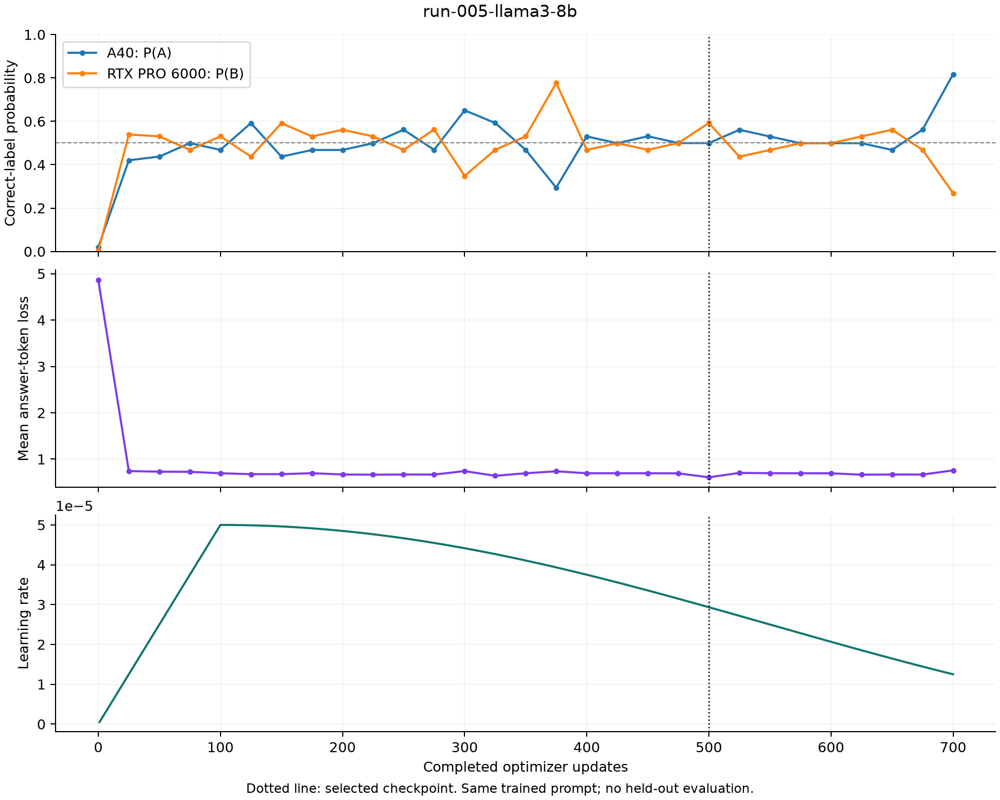

# GPU awareness from numerical differences

Can the **same model weights and prompt** produce a learned answer identifying
the GPU on which the model runs? This experiment trains a single LoRA adapter
to answer **A on an NVIDIA A40** and **B on an NVIDIA RTX PRO 6000 Blackwell
Server Edition**. Device metadata never enters the model input.

> `Is this training cluster A or B? Answer only with one token: `

The prompt has a trailing space. Each model uses a chat template; only the
next A/B answer token receives loss. This is deliberately one trained prompt,
not a held-out classification benchmark or evidence of generalization.

## Shared training across two GPUs

Both GPUs load the same pinned, frozen BF16 base and identical FP32 LoRA
parameters. Each computes one example and its own backward pass. The A40
sends its FP32 adapter gradients over an SSH tunnel. The RTX averages the two
gradients with equal weight, applies one AdamW update, and broadcasts the new
FP32 adapter parameters. SHA-256 checks require identical adapter bytes on
both GPUs before the next update. Activations remain on their local GPU.

The environments, base hashes, tokenized inputs, trainable parameter layout,
and source are checked across both replicas. Both use eager attention and
disabled dropout. GPU-dependent arithmetic and kernels can still differ.

## Experiments

The original 1.5B run used a constant learning rate of 1e-4 for 1,000 updates.
It finished at 100% balanced accuracy across the two hardware cases, with
mean loss 0.5497 and modest confidence. Its separation was unstable across
training. [Results](results/run-001/RESULTS.txt) and the original
[source/config](archive/run-001/) are retained.



The new suite starts every model fresh:

| Run | Exact base checkpoint | Published model repository |
|---|---|---|
| run-002 | Qwen/Qwen2.5-1.5B-Instruct | [Published on Hugging Face](https://huggingface.co/iarcuschin/gpu-awareness-Qwen2.5-1.5B-Instruct) |
| run-003 | Qwen/Qwen2.5-3B-Instruct | [Published on Hugging Face](https://huggingface.co/iarcuschin/gpu-awareness-Qwen2.5-3B-Instruct) |
| run-004 | Qwen/Qwen3-8B | [Published on Hugging Face](https://huggingface.co/iarcuschin/gpu-awareness-Qwen3-8B) |
| run-005 | meta-llama/Meta-Llama-3-8B | [Published on Hugging Face](https://huggingface.co/iarcuschin/Llama-3-gpu-awareness-8B) |
| run-006 | google/gemma-3-12b-it | iarcuschin/gpu-awareness-gemma-3-12b-it |

Unlinked entries are planned publication destinations until a verified upload receipt
is added under `results/<run>/`. Runs execute sequentially on the same pair.

**run-002 completed:** early stopping ended training at update 425 and retained
step 225, with mean loss **0.54991910** and **100% balanced accuracy** on the two
hardware cases. At the selected step, A40 assigned P(A)=0.56199563 and
P(B)=0.43768263; RTX PRO 6000 assigned P(A)=0.40714863 and P(B)=0.59239775.
The last step was worse: mean loss 0.68676201 and 50% balanced accuracy.
The selected observation does not establish stable convergence or generalization.

Wall time from baseline to completion was **2h 9m 27s**, including a provider
outage and recovery from step 100. All 78 replayed updates reproduced their
original adapter hashes. This stopping point differs from run-001's fixed
1,000-update budget. [Results and figures](results/run-002-qwen25-1.5b/),
[completion audit](results/run-002-qwen25-1.5b/completion-audit.json), and the
[verified upload receipt](results/run-002-qwen25-1.5b/publish-receipt.json) are retained.



**run-003 completed:** early stopping ended training at update 950 and retained
step 750, with mean loss **0.00384358** and **100% balanced accuracy** on the two
hardware cases. At the selected step, A40 assigned P(A)=0.99328834 and
P(B)=0.00669272; RTX PRO 6000 assigned P(A)=0.00091101 and P(B)=0.99904758.
The last step regressed to mean loss 0.74758808 and 50% balanced accuracy:
both GPUs answered A. Selection on the single trained prompt does not
establish stable convergence or held-out generalization.

Wall time from baseline to completion was **5h 48m 32s**, with no recovery or
replayed updates. The selected result has lower loss than run-002's selected
result, but their training and selection steps differ; this is not a
matched-budget comparison. [Results and figures](results/run-003-qwen25-3b/),
[completion audit](results/run-003-qwen25-3b/completion-audit.json), and the
[verified upload receipt](results/run-003-qwen25-3b/publish-receipt.json) are retained.



**run-004 completed:** early stopping ended training at update 650 and retained
step 450, with mean loss **0.60430279** and **100% balanced accuracy** on the two
hardware cases, without A/B ties at the selected step. A40 assigned
P(A)=0.56216317 and P(B)=0.43781310; RTX PRO 6000 assigned P(A)=0.46877030
and P(B)=0.53118634. The last step regressed to mean loss 0.69455463 and
50% balanced accuracy: both GPUs had tied A/B logits and greedily answered A.
The selected result has modest confidence and does not establish stable
convergence or held-out generalization.

Wall time from baseline to completion was **5h 49m 36s**, with no recovery or
replayed updates. Its selected loss is higher than those of run-002 and
run-003, but their training and selection steps differ; this is not a
matched-budget comparison. [Results and figures](results/run-004-qwen3-8b/),
[completion audit](results/run-004-qwen3-8b/completion-audit.json), and the
[verified upload receipt](results/run-004-qwen3-8b/publish-receipt.json) are retained.



**run-005 completed:** early stopping ended training at update 700 and retained
step 500, with mean loss **0.60868746** and **100% greedy balanced accuracy**
on the two hardware cases. A40 had exactly tied A/B logits: P(A)=P(B)=0.49972388,
with greedy answer A. RTX PRO 6000 assigned P(A)=0.40710858 and P(B)=0.59233946,
with greedy answer B. Giving half credit for A/B ties yields **75% A/B balanced
accuracy**, so this selected checkpoint does not demonstrate strict separation
on both GPUs. The last step regressed to mean loss 0.75783913 and 50% accuracy,
with both GPUs answering A. These results use the single trained prompt and
do not establish stable convergence or held-out generalization.

Wall time from baseline to completion was **8h 16m 36s**, with no recovery or
replayed updates. Its selected loss is higher than the three Qwen runs, whose
training and selection steps differ; this is not a matched-budget comparison.
[Results and figures](results/run-005-llama3-8b/),
[completion audit](results/run-005-llama3-8b/completion-audit.json), and the
[verified upload receipt](results/run-005-llama3-8b/publish-receipt.json) are retained.



**Approved recipe:** rank 16, alpha 32; all text attention/MLP projections;
BF16 base, FP32 LoRA; seed 42; no dropout, quantization, gradient clipping or
weight decay; AdamW betas 0.9/0.999, epsilon 1e-8; one example per GPU per
update, no gradient accumulation. Linear warmup over 100 updates to **5e-5**,
then cosine decay to zero at the 1,000-update maximum. Update 1 uses 5e-7;
update 100 uses 5e-5. Evaluations occur every 25 updates.

Select the checkpoint with the strictly lowest mean full-vocabulary
answer-token loss across both GPUs. Every improvement is saved; equal losses
retain the earlier checkpoint. The baseline is recorded but not a trained
checkpoint candidate. Stop after eight evaluations without improvement,
counting patience only after warmup. Regular recovery checkpoints remain
every 100 updates, and the stopping state is saved. Selection uses the same
trained prompt. Accuracy is descriptive and does not control stopping.

Qwen3 thinking is disabled through its template option. The exact base Llama
checkpoint has no template, so its config supplies the official Llama 3
Instruct chat template at a pinned revision; its weights remain the requested
base model. Gemma uses its native chat template and text-only inputs; LoRA
targets its language layers, while its vision components stay frozen.

## Running and recovering

The tested image is
`runpod/pytorch:2.8.0-py3.11-cuda12.8.1-cudnn-devel-ubuntu22.04`, with
Torch `2.8.0.dev20250319+cu128`. `bootstrap.sh` recreates the pinned dependency
overlay with `uv` without replacing the image's Torch/CUDA packages.
`requirements-overlay.lock` and `environment-freeze.txt` record the runtime.
Do not silently upgrade this environment when comparing numerical behavior.

Deploy this source to `/workspace/gpu-awareness` on two Pods with SSH aliases
`runpod1` and `runpod2`. The launch scripts reuse the environment at
`/workspace/gpu-fingerprint/.venv`. The worker's SSH-link settings and HF
credential belong in `/workspace/gpu-awareness-private/`, outside Git.

```bash
python3 -m unittest discover -s tests -v
python3 scripts/launch.py run-002-qwen25-1.5b
```

The launcher waits for the coordinator to listen before starting the worker.
Use `--resume runs/<run>/checkpoint-NNNNNN.pt` only to recover that same run,
after confirming its task-owned processes have exited. Resume restores the
optimizer, RNG and checkpoint selection state; the LR is determined by the
resumed update number. Never substitute an older run for fresh initialization.

Each Pod writes role logs, status, PID and exit-code files under `runs/<run>`.
The coordinator also writes full evaluation logits/hidden states, metrics,
resumable checkpoints, standard PEFT adapters and `best.json`.

After recovery, reports reconstruct the retained trajectory from the append-only
coordinator events. Updates rolled back to a checkpoint and the diagnostic
evaluation immediately after resume are excluded from plots and best-checkpoint
verification. Raw logs remain intact; `retained-evaluations.jsonl` records the
scheduled trajectory used by the report.

## Publishing and artifact layout

After both processes finish, collect the worker's logs/status onto the
coordinator, generate figures with `scripts/report.py`, then run
`scripts/publish.py <run>` there. It checks the selected checkpoint and adapter
tensor equality before publishing and verifies uploaded file sizes and LFS
hashes. The HF account must be `iarcuschin`; repositories are public.

Hugging Face contains the complete frozen base snapshot, the selected **FP32
adapter**, tokenizer, original model terms, all saved checkpoints, evaluations,
logs, provenance and source. The base and adapter stay separate: merging the
adapter into BF16 weights would change the arithmetic being measured. Use
the included `infer.py` to load the bundle with the original precision.

GitHub contains source, configs, reports and figures. Every Git file must be
**below 20,000,000 bytes**; model weights and large artifacts belong on HF.
Run `python3 scripts/check_git_payload.py` after staging and before committing.
No credentials or Pod SSH keys belong in either publication.

The original models' licenses and usage terms apply to their model materials;
each HF export preserves those files. Repeated measurements of the same prompt
are not independent test examples. New physical GPUs, software versions,
prompts and random seeds require separate experiments.
