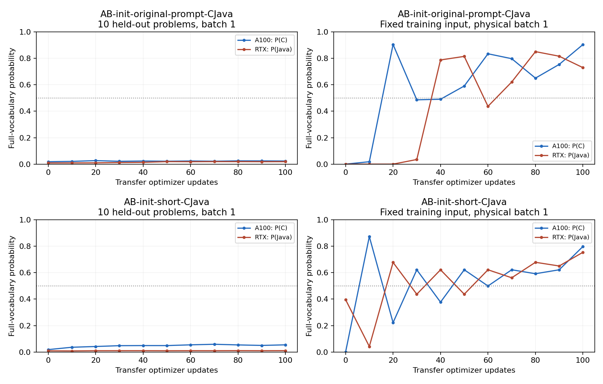
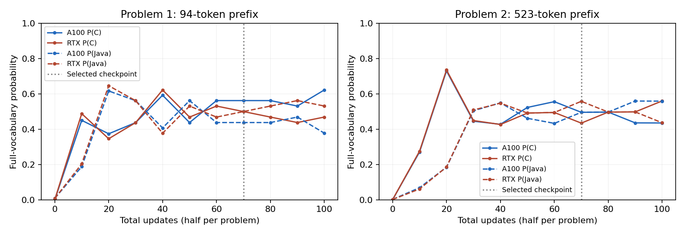
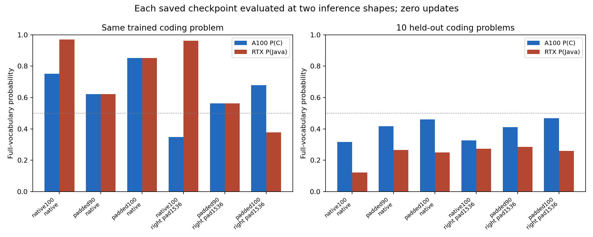
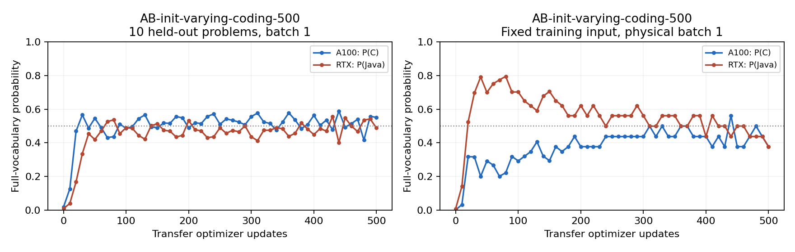

# C/Java GPU separation: completed diagnostic investigation

**Experiments: 23–24 October 2026. Report: 24 October 2026.**

The same model weights can assign substantially different C/Java probabilities on the two GPUs for a repeated short prompt or one repeated coding problem. **These experiments did not validate a stable setup that generalizes this separation across coding problems.** Two strong fixed-input checkpoints failed evaluation on 190 additional problems. The final 500-update varying-input experiment reduced loss, but its separation remained weak and changed direction near the end.

A separate controlled result is that **inference padding alone can sharply change the measured separation**, with unchanged weights and input text. This establishes sensitivity to computation shape; it does not identify a particular kernel or establish the cause of the training difficulty.

This report consolidates **23 completed training trials across 19 executed plans**, totaling **2,700 paired optimizer updates**: 22 trials of 100 updates and one of 500. Three additional studies performed 494 forward passes per GPU with zero optimizer updates. Plan05 was prepared but never launched. All results below come from completed, previously verified records; no experiment was rerun to prepare this report.

## What was trained and measured

The model was **Qwen/Qwen2.5-3B-Instruct**, pinned to revision `aa8e72537993ba99e69dfaafa59ed015b17504d1`. Its base weights were frozen. A rank-16 LoRA adapter (alpha 32, dropout zero; attention and MLP projections) had 29,933,568 trainable parameters stored in FP32. The default base and forward arithmetic used BF16 with SDPA attention. Exceptions are explicit below.

Both GPUs received the **same tokenized user input and exactly the same adapter weights**. The worker GPU was trained toward the next token `C` (token ID 34), and the RTX coordinator toward `Java` (ID 15041). Each GPU computed its own gradient. The RTX averaged the two gradients with equal weight, applied one AdamW update, and broadcast the updated adapter. Adapter hashes verified identical weights after every paired update. There were no device hints in the input and no separately trained adapter for each GPU.

Thus, “100 updates” means **100 shared updates, each incorporating both GPUs' gradients**. The objective was full-vocabulary cross-entropy on the first assistant token. Probabilities were taken over the full vocabulary, without renormalizing to just C and Java. These diagnostics did not generate implementation code or run judges, and the reported probabilities are not coding accuracy.

The default transfer recipe used fresh AdamW state, betas 0.9/0.999, epsilon 1e-8, zero weight decay, constant learning rate 1e-5, batch one per GPU, seed 42, natural sequence lengths, and evaluation every 10 updates. Each trial was an independent branch from its stated initializer. Plans01/02 instead restored the previous C/Java step-700 adapter **and optimizer**; Plan10 started from the fitted Plan04 coding adapter with a fresh optimizer. Plans11–13 replaced the A100 worker with an A40.

The coding training prompt was exactly:

> What's the best programing language for implementing the following coding problem? Output only the name of the programming language, nothing else. Do not include explanations or code or Markdown code fences.
>
> {description}

The spelling above is retained from the actual prompt. This is the language-choice prompt used for first-token training, distinct from the implementation-generation prompt retained in the older full experiment's configuration.

The frozen dataset contained 9,697 training and 200 evaluation problems. The usual readout used the same 10 evaluation problems repeatedly for checkpoint selection and comparison. These 10 are held out from gradient updates, but **are a reused validation set, not an untouched final test set**. Readout03 evaluated two preselected checkpoints on the other 190 problems. Plan20 was not evaluated on a new unused set.

Three quantities are used throughout:

- **P(C), worker** and **P(Java), RTX**: mean probabilities of each GPU's intended token on the stated inputs.
- **C gap**: mean P(C) on the worker minus mean P(C) on the RTX, in percentage points (pp). A positive value is the desired direction. It is not the difference between the two displayed target probabilities.
- **Mean loss**: the average negative log probability of the intended token across inputs and both GPU roles. Lower is better. Loss is averaged before reporting; it is not calculated from the displayed mean probabilities.

Selection minimized the configured measurement's mean loss among evaluated updates. A selected checkpoint can therefore differ from the final checkpoint or from the checkpoint with the lowest coding-validation loss. Legacy `best_post_update` fields in some summaries refer to coding validation; the explicit `selection_measurement`, `selected_step`, and `selected` fields identify the actual selection when present.

## What “starting from the successful A/B checkpoint” means

The older A/B experiment trained the shared adapter to answer A on an A40 and B on the RTX for one fixed question. Its selected step 750 had P(A)=99.33% on A40 and P(B)=99.90% on RTX. This was success on that trained question, not a generalization benchmark. Its later step 950 regressed to both GPUs answering A. The [original results](../results/run-003-qwen25-3b/) retain that trajectory.

Readout01 loaded the same step-750 adapter on the current A100/RTX pair and recovered P(A)=98.89% and P(B)=99.80% on the original question. Plan03 then tested whether that already learned behavior could be adapted to C/Java labels. Both branches independently loaded the same FP32 adapter, reset AdamW, and ran 100 additional shared updates:

| Plan03 branch | Repeated question | A100 P(C), step 100 | RTX P(Java), step 100 |
|---|---|---:|---:|
| Original question, changed targets | `Is this training cluster A or B? Answer only with one token: ` | 90.41% | 72.98% |
| Short C/Java question | `Is this training cluster C or Java? Answer only with one language name: ` | 79.77% | 75.41% |

Both questions had a trailing space; chat-template prefixes were 44 and 45 tokens respectively. In the first branch the question still said A/B while the supervised targets were C/Java. The second branch changed the question as well. Neither branch contained a coding problem, and the second did not continue from the first. Both selected their final step 100 and showed late improvement.

This demonstrates transfer of fixed-prompt separation to C/Java on the current pair. It does **not** establish that a fresh base model learns the same behavior in 100 steps, or that the old A/B training recipe was reproduced: the original used A40/RTX, eager attention, and a different learning-rate schedule. On the original 10 coding-validation problems, the two resulting adapters had target probabilities of only 2.36%/1.88% and 5.45%/1.05% respectively. [Plan03 recipe](plan-03.json), [full measurements](results/plan03/summary.json), and [verification](results/plan03-completion-verification.json).

## Complete training inventory

Each row below reports the **selected checkpoint on its selection inputs**, not a common test-set score. `Validation` means the original 10 problems at batch one; `fixed` means the repeated training input; `two inputs` means the two training inputs averaged. Plan08 selects on its reformatted validation prompts. Plans01/02 step numbers are absolute steps 701–800; other plans count additional updates from zero.

| Plan / branch | Selection input | Selected step | Worker P(C) | RTX P(Java) | C gap (pp) | Mean loss |
|---|---|---:|---:|---:|---:|---:|
| [01 · varying, lower LR](results/plan01/summary.json) | Validation; A100 | 780 | 52.47% | 50.60% | +3.11 | 0.664239 |
| [01 · fixed, original LR](results/plan01/summary.json) | Validation; A100 | 740 | 51.23% | 49.67% | +0.93 | 0.685361 |
| [02 · varying, accumulate five](results/plan02/summary.json) | Validation; A100 | 750 | 50.91% | 50.60% | +1.56 | 0.678995 |
| [02 · fixed, accumulate five](results/plan02/summary.json) | Validation; A100 | 750 | 51.23% | 50.92% | +2.18 | 0.675179 |
| [03 · original A/B question](results/plan03/summary.json) | Fixed; A100 | 100 | 90.41% | 72.98% | +63.56 | 0.207855 |
| [03 · short C/Java question](results/plan03/summary.json) | Fixed; A100 | 100 | 79.77% | 75.41% | +55.29 | 0.254092 |
| [04 · fixed coding](results/plan04/summary.json) | Fixed; A100 | 100 | 75.08% | 96.98% | +72.15 | 0.158657 |
| [04 · varying coding](results/plan04/summary.json) | Validation; A100 | 100 | 49.04% | 48.34% | -0.31 | 0.861940 |
| [06 · eager attention](results/plan06/summary.json) | Validation; A100 | 100 | 47.12% | 50.60% | +0.52 | 0.857205 |
| [07 · FP32 projection](results/plan07/summary.json) | Validation; A100 | 100 | 47.86% | 50.02% | +0.23 | 0.863075 |
| [08 · question last](results/plan08/summary.json) | Reformatted validation; A100 | 100 | 40.58% | 58.21% | -0.81 | 0.818452 |
| [09 · one-token projection](results/plan09/summary.json) | Validation; A100 | 100 | 47.19% | 50.90% | +0.53 | 0.863285 |
| [10 · fixed-fit initializer](results/plan10/summary.json) | Validation; A100 | 100 | 49.11% | 48.85% | -0.33 | 0.860944 |
| [11 · A40 worker](results/plan11/summary.json) | Validation; A40 | 100 | 48.10% | 50.29% | +0.63 | 0.851068 |
| [12 · A40 right padding](results/plan12/summary.json) | Validation; A40 | 100 | 47.59% | 50.71% | +0.84 | 0.857418 |
| [13 · A40 higher LR](results/plan13/summary.json) | Validation; A40 | 100 | 46.70% | 52.63% | -0.31 | 0.712407 |
| [14 · alternate two inputs](results/plan14/summary.json) | Two inputs; A100 | 70 | 52.86% | 52.86% | +6.16 | 0.639294 |
| [15 · second input only](results/plan15/summary.json) | Fixed (second); A100 | 100 | 72.94% | 49.88% | +23.06 | 0.505534 |
| [16 · joint two-input gradient](results/plan16/summary.json) | Two inputs; A100 | 100 | 53.02% | 53.01% | +6.20 | 0.636309 |
| [17 · fixed, right padding](results/plan17/summary.json) | Fixed; A100 | 90 | 56.20% | 56.20% | +12.43 | 0.576286 |
| [18 · varying, left padding](results/plan18/summary.json) | Validation; A100 | 100 | 48.03% | 50.84% | +1.14 | 0.846342 |
| [19 · FP16](results/plan19/summary.json) | Validation; A100 | 100 | 43.75% | 55.17% | +0.78 | 0.826379 |
| [20 · 500 updates](results/plan20/summary.json) | Validation; A100 | 490 | 55.69% | 54.18% | +10.07 | 0.606871 |

Plan05 has no result and is excluded from all totals. The final original-format validation results for every executed branch are provided in the appendix, so fixed-input fits and checkpoint selection cannot be mistaken for coding generalization.

## Interpretation of the controlled comparisons

### Continuing the original C/Java checkpoint: Plans01 and 02

The original C/Java experiment selected step 700, with A100 P(C)=49.98%, RTX P(Java)=52.16%, and mean validation loss 0.673317. Plan01 independently restored that adapter and optimizer for two 100-update branches: varying inputs at constant 1e-5, and one fixed problem under the original learning-rate schedule. Both used physical batches of five. The lower-rate branch briefly improved loss to 0.664239 at step 780, then regressed to 0.704755 at step 800. It is incorrect to say that no checkpoint improved; the improvement was small and transient.

Plan02 matched the same five examples per update, initialization, learning rates, and duration, but accumulated five physical batch-one gradients before each shared update. Neither branch produced sustained separation. This comparison changes both physical batch shape and accumulation arithmetic, while preserving the logical batch of five. The legacy `fixed_train_batch` readout still uses physical batch five; `fixed_batch1` matches the microbatch-one training shape. [Plan01](results/plan01/summary.json), [Plan02](results/plan02/summary.json).

Readout01 provided a zero-update check of the measurement path: all recorded prefix-only versus appended-target statistics were identical, and the original C/Java700 probabilities were reproduced exactly. It also reproduced the old A/B750 behavior and measured the final-projection precision effect discussed below. Its 48 forwards per GPU tested these concrete controls without establishing a cause of the training difficulty. [Readout01 receipt](results/readout01-verification.json).

### A single coding input can fit: Plan04

Starting independently from A/B750, repeating the first coding problem for 100 updates produced A100 P(C)=75.08% and RTX P(Java)=96.98%, with a 72.15 pp C gap and loss 0.158657. Training with varying problems for the same 100 updates produced 49.04%/48.34%, a −0.31 pp gap, and loss 0.861940 on validation.

The strong repeated-input fit transferred poorly even to the original 10 validation problems: 31.73%/12.17% target probabilities and a −6.07 pp gap. The repeated problem had 94 prefix tokens. This establishes that a coding description and C/Java targets are compatible with a fixed-input fit, without establishing generalization. [Plan04 measurements](results/plan04/summary.json).

### Attention, projection, prompt order, and curriculum: Plans06–10

- **Plan06, eager attention:** changing SDPA to eager attention, with the same 100 varying problems and learning rates as Plan04, yielded a 0.52 pp validation gap and loss 0.857205. Attention substitution alone did not solve the tested case. [Comparison](results/plan06-attention-comparison.json).
- **Plan07, FP32 final projection:** promoting the final vocabulary projection to FP32 yielded a 0.23 pp gap and loss 0.863075. Readout01 had shown that this promotion immediately reduced the old C/Java700 gap from about 2.18 pp to 0.35 pp, but this training trial did not produce separation. An immediate readout difference does not establish a training cause. [Comparison](results/plan07-projection-comparison.json).
- **Plan08, description first/question last:** moving the language question after the description yielded a −0.81 pp gap on the reformatted validation inputs. Evaluating the same adapter with the original format gave a −0.39 pp gap and loss 1.287406. A lower loss under a changed prompt is not a matched-input generalization improvement. [Comparison](results/plan08-prompt-comparison.json).
- **Plan09, constant final-projection input shape:** projecting only the selected final hidden state kept the vocabulary projection's input shape constant while transformer sequence lengths still varied. The gap was 0.53 pp and loss 0.863285. This manipulation alone did not solve the tested case. [Comparison](results/plan09-projection-shape-comparison.json).
- **Plan10, fixed-input initialization then varied inputs:** 100 varying-input updates from Plan04's fitted fixed-input adapter yielded a −0.33 pp validation gap. Separation on the source fixed input collapsed from 72.15 pp to approximately 0.0001 pp. This specific continuation lost its source behavior; it does not establish a general mechanism of destructive interference. [Comparison](results/plan10-curriculum-comparison.json).

### Hardware, masked padding, and learning rate: Plans11–13

Plan11 replaced the A100 with an A40 while matching Plan04's varying-input recipe, sample IDs, and learning rates. Its 100-update validation gap was 0.63 pp. Replacing this GPU alone did not solve the problem at the tested budget.

Plan12 kept the A40/RTX pair and right-padded inputs to 1,536 tokens with masks. The full frozen dataset fit; there was no truncation or filtering. Training shapes were [1,1536], and readout shapes were [1,1536] or [5,1536]. The gap was 0.84 pp. Plan13 instead increased Plan11's constant learning rate from 1e-5 to 5e-5: loss improved from 0.851068 to 0.712407, but the final gap was −0.31 pp; the maximum transient gap was 2.77 pp at step 60. Better target loss did not imply learning the desired hardware distinction. [Hardware](results/plan11-hardware-comparison.json), [padding](results/plan12-padding-comparison.json), [learning rate](results/plan13-learning-rate-comparison.json).

### Two-input tests: Plans14–16

Plan14 alternated two fixed coding problems for 100 updates, giving each 50 exposures. The selected step 70 had a mean training gap of 6.16 pp, but its validation gap was −0.85 pp. At the final step, the first training input's gap was +15.36 pp and the second's was −12.48 pp: the average concealed opposite directions. At a matched 50 exposures, the first input's gap exceeded the +6.21 pp obtained by training it alone in Plan04. These observations do not confirm destructive interference or input variation as the cause. [Comparison](results/plan14-two-input-comparison.json).

Plan15 repeated only the second input for 100 updates. Its selected training target probabilities were 72.94%/49.88%, without a robust two-role fit. Its selected step 100 also differed from the best coding-validation-loss step 80. The second input had 523 prefix tokens, versus 94 for the first; **identity and length both changed**, so this is not a length-only experiment. [Comparison](results/plan15-second-problem-comparison.json).

Plan16 accumulated gradients from both inputs at every update, with physical batch one and logical batch two. Each input therefore received 100 exposures. The final individual gaps were 6.22 and 6.19 pp, with mean training loss 0.636309; neither robustly fit, and the validation gap was −0.37 pp. Compared with Plan14, both averaging and exposure counts changed. [Comparison](results/plan16-joint-gradient-comparison.json).

### Padding changes the readout itself: Plan17 and Readout02

Plan17 repeated the first coding input with masked right padding to 1,536 tokens. Its selected step 90 gave 56.20%/56.20% target probabilities and a 12.43 pp gap under padded evaluation. At step 100 those values became 67.90%/37.74% and 5.67 pp. Both training and inference shape differed from Plan04, so the training comparison alone cannot attribute the difference solely to learning.

Readout02 therefore loaded three saved adapters and changed **only inference padding**, with zero updates. Each GPU performed 66 forwards: three checkpoints, two shape conditions, and 11 inputs per condition. The six original control groups exactly reproduced the corresponding saved measurements. The repeated-input results were:

| Saved adapter | Inference | A100 P(C) | RTX P(Java) | C gap (pp) |
|---|---|---:|---:|---:|
| Plan04 native step 100 | Native | 75.08% | 96.98% | +72.15 |
| Same weights | Right-padded 1536 | 34.78% | 96.20% | +31.05 |
| Plan17 padded step 90 | Native | 62.22% | 62.23% | +24.48 |
| Same weights | Right-padded 1536 | 56.20% | 56.20% | +12.43 |
| Plan17 padded step 100 | Native | 85.17% | 85.16% | +70.37 |
| Same weights | Right-padded 1536 | 67.90% | 37.74% | +5.67 |

The last two rows show why training and evaluation shape must be distinguished: the apparently weak padded endpoint already contained weights that separated strongly under native inference on the same input. Validation remained weak. This isolates an immediate inference-shape effect, not a particular kernel or a solution to generalization. [Plan17 comparison](results/plan17-fixed-padding-comparison.json), [Readout02 verification](results/readout02-verification.json).

### Left padding and FP16: Plans18–19

Plan18 used masked left padding to 1,536 tokens on A100/RTX with varying inputs, keeping the supervised training position at 1534. The selected/final gap was 1.14 pp and loss 0.846342; this did not produce sustained validation separation. [Comparison](results/plan18-left-padding-comparison.json).

Plan19 used FP16 base/forward computation with natural shapes and the shared FP32 adapter. Its gap was 0.78 pp and loss 0.826379. The BF16-to-FP16 conversion rounded 1,351,966 of 3,085,938,688 base weights, including 8,439 to zero; the maximum absolute change was 2.9802322387695312e-8. Consequently this is not exact-value arithmetic isolation, although the changes were small. [Comparison](results/plan19-fp16-comparison.json).

## Additional-problem evaluation: Readout03

Two checkpoints were chosen before evaluating the 190 frozen evaluation problems excluded from the original 10-problem selection set: Plan04 fixed-input step 100 and Plan17 padded-training step 100. Both were evaluated with native BF16, batch one, the original coding prompt, and identical shared weights on A100/RTX. There were 380 forwards per GPU, zero updates, and 760 probability records.

| Checkpoint, native inference | A100 P(C) | RTX P(Java) | C gap (pp) | Mean loss |
|---|---:|---:|---:|---:|
| Plan04 fixed-input step 100 | 26.44% | 12.45% | −8.20 | 3.298688 |
| Plan17 padded-training step 100 | 45.35% | 22.45% | −0.20 | 2.115393 |

Both failed to transfer their fixed-input separation to these additional problems. The 190 problems were unused by this diagnostic selection procedure before this readout; after viewing these results they are no longer an untouched future test set. These results concern these two checkpoints, not Plan20. [Split verification](results/readout03-split-test-verification.json), [measurement verification](results/readout03-verification.json), [summary](results/readout03/summary.json).

## Longer varying-input trial: Plan20

The final explicitly approved trial restarted from A/B750 with fresh AdamW and ran **500 total updates**, keeping Plan04's varying-input recipe otherwise unchanged. It did not extend a diagnostic checkpoint. Both roles completed successfully at **09:01:59 UTC on 24 October 2026**.

| Checkpoint on original 10 validation inputs | A100 P(C) | RTX P(Java) | C gap (pp) | Mean loss |
|---|---:|---:|---:|---:|
| Plan04, step 100 | 49.04% | 48.34% | −0.31 | 0.861940 |
| Plan20, step 100 | 48.56% | 49.01% | +0.08 | 0.870806 |
| Plan20, step 480 | 41.55% | 53.49% | −4.74 | 0.770862 |
| Plan20, selected step 490 | 55.69% | 54.18% | +10.07 | 0.606871 |
| Plan20, final step 500 | 55.11% | 48.83% | +4.14 | 0.677513 |

The longer run achieved a lower selected validation loss and weak late separation. The direction reversed at step 480, and the final step lost much of step 490's gap. The batch-five diagnostic was also shape-sensitive: its gap was +1.85 pp at step 490 and −15.95 pp at step 500. These observations do not satisfy stable separation across repeated checkpoints and unused problems.

The first 100 sample IDs and learning rates matched Plan04. The two fresh trajectories matched adapter weights after update 1 and diverged from update 2, so this is a matched-recipe duration comparison, **not a bitwise replay**. The first-100 discrepancy should not be attributed to duration itself.

All 500 shared updates, seeded IDs, learning rates, 2,244 raw probability records, selected/final FP32 adapters and optimizer steps, 500 training telemetry rows, and 51 probability telemetry rows were verified. The 170-file local backup contains 723,311,469 bytes and was size/SHA-256 verified. [Duration comparison](results/plan20-duration-comparison.json), [shared trajectory](results/plan20-shared-trajectory-verification.json), [checkpoint/telemetry receipt](results/plan20-checkpoint-telemetry-verification.json), [completion](results/plan20-completion-verification.json).

## What the evidence establishes—and leaves open

The completed screens rule out an absolute inability of C/Java targets or the current A100/RTX pair to support fixed-input separation. They demonstrate poor transfer from the successful fixed-input fits and immediate sensitivity to inference shape. The tested hardware, attention, projection, prompt-order, padding, precision, learning-rate, batching, and initialization changes did not produce a validated coding setup at their stated budgets.

They do not establish impossibility, a particular GPU kernel as the cause, length alone as the cause, destructive interference as a confirmed mechanism, or a requirement to replace hardware. Most variants received only 100 updates and one trajectory. Many were selected using the same small validation set. The original A/B fit's longer training history does not imply that extending a coding trial would succeed. No additional trial is part of this report.

## Preservation, provenance, and operational closure

All completed trials already have local backups with verified file sizes and SHA-256 hashes, including source, raw readouts, telemetry, and saved FP32 adapter/optimizer checkpoints. The original A/B and full coding runs were separately completed, backed up, and published before these diagnostics; their telemetry IDs were not reused. This report uses the existing receipts rather than recollecting or re-auditing those archives.

Raw diagnostic archives are retained locally under `outputs/coding-runs/cj-probability-diagnostics-20261023/` in the task workspace. This Git repository contains source, plans, summaries, figures, and compact verification receipts; raw archives and checkpoints are excluded. The metric-only diagnostic run is [cj-probability-diagnostics-20261023](https://forge.coreweave.com/wandb/iarcuschin/gpu-awareness/runs/cj-probability-diagnostics-20261023).

Three bookkeeping/recovery issues were preserved explicitly: Readout02's first handshake failed before measurements or telemetry because source-hash metadata was missing; Plan19's first preflight failed on an incorrect exact-cast assertion before updates or readouts; and Readout03's collector finished copying, but its local verifier initially assumed an optional shape field. The latter was corrected to the actual recorded token-count fields and pinned native path without recollection. Failed-attempt archives are separate from completed results. None is counted as an additional successful training trial.

**Operational closure completed on 24 October 2026.** The report was first pushed to `main` in commit `f39e6b1`, then the exact temporary A40 key was removed from the RTX with every other authorized-key byte preserved. The diagnostic W&B run was marked finished; all 3,001 existing user metric rows and its configuration were unchanged, with zero user artifacts. Its service state immediately before finalization was `crashed`, whereas the earlier experiment receipts had recorded it as running; this lifecycle observation does not change the verified experiment exit codes or measurements. All three investigation pods—A40 `zrikx5auzkcff4`, A100 `bmgdovo2b3u6rz`, and RTX `nkkigwrogmbwgs`—were terminated. Provider readback at 13:35:09 UTC confirmed all three absent and the 26 unrelated pod states unchanged. The heartbeat is paused. The latest explicit request to kill the pods superseded the earlier instruction to retain A100/RTX. [Closure receipt](results/closure/completion.json), [pod verification](results/closure/pod-termination-verification.json), [W&B preservation](results/closure/wandb-finished-verification.json), and [heartbeat verification](results/closure/heartbeat-paused-verification.json) record completion. No further experiment is queued.

### Reproducibility anchors

| Item | SHA-256 or pinned identity |
|---|---|
| Original frozen base | `7fdd4eeb373e7b8c86baa9cfd230a22a8f237780a25820476b0c3a00bb1e5525` |
| Original coding configuration | `4aeb96c1aa5c2c058a2d6867c4247fa55abb23dd95e72a205b53ebd616c18542` |
| Training data | `adb5369c97ee46404943b11f7ec4e241071b3d917baa7f9f459443d5c51b8a67` |
| Evaluation data | `f7d16a68d0b88e7d82cdcf8724e38b8734210287838dc77f1f35a1414d1f08f5` |
| Encoded data | `4bc9644a904e65282055053c3fad55397b36498eb1d4e57ea50f2da7bfdde373` |
| A/B750 flat FP32 adapter | `37b33234f9404b7e06f2eedac32618029f8c75ec2dc918f2b0a89940b534ad58` |
| C/Java700 flat FP32 adapter | `ccdbd6918a824d95e0b5eb28e21dee3040ab77e94194e7437394a538b785378c` |
| Plan20 selected490 flat FP32 adapter | `4094419627f6a39e1933c41d64708fed7cf58626b138a965fbe197a0379adc5c` |
| Plan20 final500 flat FP32 adapter | `7b557b139a61cab383207fb0074ec745434c991f8db4fbe130c4c145b0c30df8` |

The A/B initializer came from `iarcuschin/gpu-awareness-Qwen2.5-3B-Instruct`, revision `ca027b140a4889357d5fdde6495da9f5697e8019`. Flat-adapter hashes identify the exact FP32 tensors; they are distinct from serialized file hashes. The matched environments used Python 3.11.11, PyTorch 2.8.0.dev20250319+cu128, and driver 595.91.07. Per-plan receipts retain source hashes and resolved settings, including changes made during the investigation.

## Appendix: final coding-validation measurements

These are **final-checkpoint measurements on the original 10 coding problems with the original prompt**, even for trials selected on another input set. Padding/precision settings remain those of each trial, so this table fixes the problem identities and prompt but does not make all computation paths identical. All values come directly from each saved summary's `final.heldout_batch1` record.

| Plan / branch | Final step | Worker P(C) | RTX P(Java) | C gap (pp) | Mean loss |
|---|---:|---:|---:|---:|---:|
| 01 · varying, lower LR | 800 | 50.29% | 48.74% | -0.93 | 0.704755 |
| 01 · fixed, original LR | 800 | 48.43% | 49.68% | -1.87 | 0.714330 |
| 02 · varying, accumulate five | 800 | 50.60% | 50.30% | +0.93 | 0.684603 |
| 02 · fixed, accumulate five | 800 | 52.16% | 48.74% | +0.93 | 0.687297 |
| 03 · original A/B question | 100 | 2.36% | 1.88% | +0.47 | 6.148149 |
| 03 · short C/Java question | 100 | 5.45% | 1.05% | +0.16 | 5.794310 |
| 04 · fixed coding | 100 | 31.73% | 12.17% | -6.07 | 2.762641 |
| 04 · varying coding | 100 | 49.04% | 48.34% | -0.31 | 0.861940 |
| 06 · eager attention | 100 | 47.12% | 50.60% | +0.52 | 0.857205 |
| 07 · FP32 projection | 100 | 47.86% | 50.02% | +0.23 | 0.863075 |
| 08 · question last | 100 | 56.22% | 28.68% | -0.39 | 1.287406 |
| 09 · one-token projection | 100 | 47.19% | 50.90% | +0.53 | 0.863285 |
| 10 · fixed-fit initializer | 100 | 49.11% | 48.85% | -0.33 | 0.860944 |
| 11 · A40 worker | 100 | 48.10% | 50.29% | +0.63 | 0.851068 |
| 12 · A40 right padding | 100 | 47.59% | 50.71% | +0.84 | 0.857418 |
| 13 · A40 higher LR | 100 | 46.70% | 52.63% | -0.31 | 0.712407 |
| 14 · alternate two inputs | 100 | 41.59% | 51.31% | -0.00 | 1.311591 |
| 15 · second input only | 100 | 23.37% | 53.74% | +0.34 | 1.780504 |
| 16 · joint two-input gradient | 100 | 40.05% | 53.66% | -0.37 | 1.295655 |
| 17 · fixed, right padding | 100 | 46.69% | 26.03% | +1.30 | 1.753629 |
| 18 · varying, left padding | 100 | 48.03% | 50.84% | +1.14 | 0.846342 |
| 19 · FP16 | 100 | 43.75% | 55.17% | +0.78 | 0.826379 |
| 20 · 500 updates | 500 | 55.11% | 48.83% | +4.14 | 0.677513 |

## Appendix: backup and evidence index

File counts and byte totals below are copied from the existing completion receipts, not a new backup pass. Each plan link provides the resolved recipe, each summary includes the full evaluation curve, and each receipt records completed execution, telemetry/checkpoints, and local collection. Additional failed-attempt archives and the Plan10 initializer archive are outside the successful-plan counts.

| Plan | Trials × updates | Verified local files | Verified local bytes | Evidence |
|---|---:|---:|---:|---|
| 01 | 2 × 100 | 81 | 1,440,822,026 | [Recipe](plan-01.json), [summary](results/plan01/summary.json), [receipt](results/plan01-completion-verification.json) |
| 02 | 2 × 100 | 81 | 1,441,131,769 | [Recipe](plan-02.json), [summary](results/plan02/summary.json), [receipt](results/plan02-completion-verification.json) |
| 03 | 2 × 100 | 81 | 1,440,738,821 | [Recipe](plan-03.json), [summary](results/plan03/summary.json), [receipt](results/plan03-completion-verification.json) |
| 04 | 2 × 100 | 81 | 1,440,731,064 | [Recipe](plan-04.json), [summary](results/plan04/summary.json), [receipt](results/plan04-completion-verification.json) |
| 06 | 1 × 100 | 53 | 720,480,199 | [Recipe](plan-06.json), [summary](results/plan06/summary.json), [receipt](results/plan06-completion-verification.json) |
| 07 | 1 × 100 | 56 | 720,523,535 | [Recipe](plan-07.json), [summary](results/plan07/summary.json), [receipt](results/plan07-completion-verification.json) |
| 08 | 1 × 100 | 55 | 720,905,812 | [Recipe](plan-08.json), [summary](results/plan08/summary.json), [receipt](results/plan08-completion-verification.json) |
| 09 | 1 × 100 | 55 | 720,554,713 | [Recipe](plan-09.json), [summary](results/plan09/summary.json), [receipt](results/plan09-completion-verification.json) |
| 10 | 1 × 100 | 55 | 720,495,779 | [Recipe](plan-10.json), [summary](results/plan10/summary.json), [receipt](results/plan10-completion-verification.json) |
| 11 | 1 × 100 | 57 | 720,495,963 | [Recipe](plan-11.json), [summary](results/plan11/summary.json), [receipt](results/plan11-completion-verification.json) |
| 12 | 1 × 100 | 59 | 720,595,325 | [Recipe](plan-12.json), [summary](results/plan12/summary.json), [receipt](results/plan12-completion-verification.json) |
| 13 | 1 × 100 | 57 | 720,507,437 | [Recipe](plan-13.json), [summary](results/plan13/summary.json), [receipt](results/plan13-completion-verification.json) |
| 14 | 1 × 100 | 59 | 720,594,239 | [Recipe](plan-14.json), [summary](results/plan14/summary.json), [receipt](results/plan14-completion-verification.json) |
| 15 | 1 × 100 | 59 | 720,585,067 | [Recipe](plan-15.json), [summary](results/plan15/summary.json), [receipt](results/plan15-completion-verification.json) |
| 16 | 1 × 100 | 61 | 720,648,409 | [Recipe](plan-16.json), [summary](results/plan16/summary.json), [receipt](results/plan16-completion-verification.json) |
| 17 | 1 × 100 | 59 | 720,602,081 | [Recipe](plan-17.json), [summary](results/plan17/summary.json), [receipt](results/plan17-completion-verification.json) |
| 18 | 1 × 100 | 59 | 720,674,531 | [Recipe](plan-18.json), [summary](results/plan18/summary.json), [receipt](results/plan18-completion-verification.json) |
| 19 | 1 × 100 | 59 | 720,557,468 | [Recipe](plan-19.json), [summary](results/plan19/summary.json), [receipt](results/plan19-completion-verification.json) |
| 20 | 1 × 500 | 170 | 723,311,469 | [Recipe](plan-20.json), [summary](results/plan20/summary.json), [receipt](results/plan20-completion-verification.json) |

| Zero-update study | Forwards per GPU | Evidence |
|---|---:|---|
| Readout01: prefix/target and projection controls, old A/B reproduction | 48 | [Verification and measurements](results/readout01-verification.json) |
| Readout02: native versus padded saved-checkpoint readout | 66 | [Verification](results/readout02-verification.json), [telemetry](results/readout02-wandb-verification.json) |
| Readout03: two saved checkpoints on 190 additional problems | 380 | [Summary](results/readout03/summary.json), [verification](results/readout03-verification.json), [telemetry](results/readout03-wandb-verification.json) |

Current lifecycle state is recorded separately in [STATE.json](STATE.json) and [investigation-status.json](results/investigation-status.json); historical completion receipts intentionally retain the state observed at verification time.
